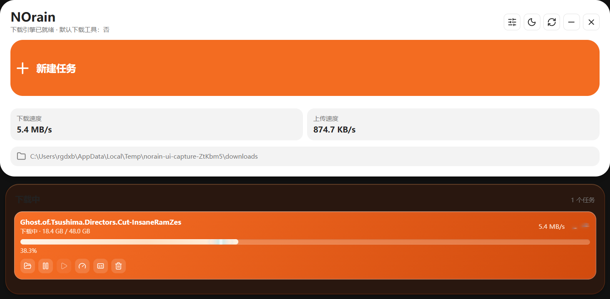
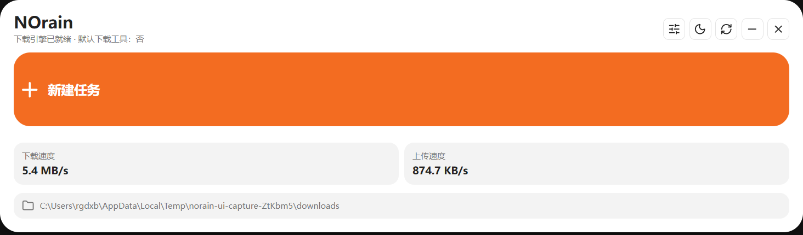

<div align="center">

# NOrain

**把链接交给它，其余交给下载引擎。**

面向 Windows 与 macOS、本地运行的多协议下载与字幕控制中心。

    



GitHub Pages 详情页位于 [`docs/`](docs/) · [快速开始](#快速开始) · [浏览器扩展](#浏览器扩展)

</div>

## NOrain 是什么

NOrain 面向不想在多个工具之间来回切换的 Windows 与 macOS 用户。它把 HTTP、FTP、磁力链接、BT 种子、在线视频页面以及浏览器下载收进同一个入口，并在本地调用成熟引擎完成任务。

普通文件用浏览器就够了。NOrain 处理的是更复杂的情况：大文件、断点续传、BT 文件选择、视频流解析、批量队列，以及下载完成后的快速定位。

它不是为了取代浏览器的每一次下载，而是在链接、协议、片源和后续整理开始变复杂时，提供一个安静、明确且持续运行的本地控制入口。

## 为什么使用 NOrain

| 场景 | 浏览器下载 | NOrain |
| --- | --- | --- |
| 大文件与断点续传 | 依赖浏览器能力 | aria2 分段、续传与队列 |
| Magnet / BT | 通常需要其他工具 | 直接添加并选择种子文件 |
| 在线视频 | 保存能力有限 | yt-dlp 解析，ffmpeg 合并 |
| 浏览器接管 | 下载分散在多个入口 | 扩展发送到统一任务队列 |
| 后台执行 | 关闭浏览器可能中断 | 托盘、计划任务和系统通知 |
| 下载后的字幕 | 需要另行寻找 | 任务、本地文件与在线源统一匹配 |

## 核心特征

- **自动分析剪贴板**：打开新建任务时识别可下载内容并自动填入。
- **统一任务入口**：链接、磁力、种子文件和视频页面无需切换模式。
- **下载前确认**：选择保存目录、调整文件名，再开始任务。
- **BT 文件选择**：按需下载种子中的文件，避免无关内容占用空间。
- **多引擎协作**：aria2 处理常规链接与 BT，yt-dlp 和 ffmpeg 处理视频资源。
- **浏览器接管**：通过扩展把 Chrome 或 Edge 的下载任务交给桌面端。
- **紧凑无边框界面**：窗口随内容伸展，任务坞默认隐藏并在靠近时完整展开。
- **直接定位文件**：打开下载位置时由资源管理器选中目标文件。
- **本地优先**：任务数据和下载过程留在本机，不依赖云端中转。
- **托盘后台运行**：关闭窗口后保持下载引擎、计划任务与浏览器接管运行。
- **系统通知**：任务完成或失败时发送 Windows 通知，点击即可回到任务位置。
- **计划任务**：支持单次或每日计划，重启后仍会保留。
- **分层限速**：全局下载、全局上传、并发数量与单任务速度可以分别控制。
- **字幕中心**：支持视频页面字幕、下载中任务预检索、本地视频哈希匹配、内嵌字幕提取、同目录字幕识别、SubDL、OpenSubtitles 与指定链接获取。

## 设计展示

| 紧凑预览 | 完整任务 |
| --- | --- |
|  |  |

主界面只保留新建任务、实时速度和默认目录。下载任务吸附在主体之后：收起时只显示完整进度轨道，靠近后再展示名称、进度和操作按钮。最快任务会获得沿进度轨道流动的高光，让速度成为有意义的视觉信号。

## 字幕中心

字幕中心覆盖下载前后不同阶段，而不是只读取视频网页自带的字幕：

| 获取方式 | 使用时机 | 匹配依据 |
| --- | --- | --- |
| 下载任务预检索 | 视频或 BT 尚在下载 | 片名、年份、季集、发布组 |
| 本地视频分析 | 已有完整视频文件 | OpenSubtitles 影片哈希与文件名 |
| 同目录扫描 | 视频旁已有字幕 | 文件名与语言后缀 |
| 内嵌字幕提取 | MKV、MP4 等容器带字幕流 | 字幕轨道、语言与编码 |
| 视频页面字幕 | yt-dlp 支持的视频页面 | 人工字幕与自动字幕语言 |
| 在线字幕源 | 配置自己的 API Key 后 | SubDL / OpenSubtitles |
| 指定链接 | 已知字幕下载地址 | SRT、ASS、VTT、SUB、SUP 或 ZIP |

字幕默认保存为与视频同名的语言文件，例如 `Movie.zh-CN.srt`。在线字幕源密钥只写入本机运行目录；没有密钥时，本地扫描、内嵌提取和视频页面字幕仍然可用。NOrain 目前不包含 Whisper 语音识别或硬字幕 OCR，因此不需要额外下载数 GB 的模型。

## 支持内容

| 内容 | 执行方式 | 能力 |
| --- | --- | --- |
| HTTP / HTTPS / FTP | aria2 | 分段、续传、队列 |
| Magnet / `.torrent` | aria2 | BT 下载、文件选择 |
| 视频页面 / HLS / DASH | yt-dlp + ffmpeg | 解析、合并音视频 |
| 浏览器下载 | NOrain 扩展 | 捕获并发送到桌面端 |

> NOrain 不绕过 DRM、付费墙、登录限制或资源所有者设置的访问权限。请只下载你有权保存的内容。

## 快速开始

源码运行需要 Windows 10/11 或 macOS 12 及 Node.js 22 或更高版本。

```powershell
npm install
npm run desktop
```

首次运行会准备 aria2、yt-dlp 和 ffmpeg。仅启动本地服务与网页界面：

```powershell
npm start
```

默认地址为 `http://127.0.0.1:4288`。

构建桌面版本：

```powershell
npm run pack
# Windows 安装版与便携版
npm run dist:win
# macOS DMG 与自动更新 ZIP（必须在 macOS 构建）
npm run dist:mac
```

## 软件更新

- 已安装版本启动后自动检查稳定通道，每 6 小时复查一次。
- “下载工具 → 更新”可以关闭自动检查、手动检查、查看下载进度并重启安装。
- Windows 使用 NSIS 增量更新；macOS 使用签名后的 ZIP 更新，DMG 供首次安装。
- Git 标签 `v*` 会触发 `.github/workflows/release.yml`，自动发布 Windows、Intel Mac 与 Apple Silicon Mac 文件及更新元数据。
- macOS 自动更新要求 Developer ID 签名和 Apple 公证。仓库需配置 `MAC_CSC_LINK`、`MAC_CSC_KEY_PASSWORD`、`APPLE_ID`、`APPLE_APP_SPECIFIC_PASSWORD`、`APPLE_TEAM_ID`；Windows 签名可配置 `WIN_CSC_LINK` 与 `WIN_CSC_KEY_PASSWORD`。

## 浏览器扩展

1. 在 Chrome 或 Edge 打开扩展管理页。
2. 开启“开发者模式”。
3. 选择“加载已解压的扩展程序”。
4. 源码运行时选择项目中的 `extension` 目录；打包版可从托盘菜单选择“打开浏览器扩展目录”。
5. 保持 NOrain 桌面端运行，浏览器下载会被发送到本地服务。

## 工作方式


## 项目状态

NOrain 目前处于 **Alpha** 阶段。核心下载链路、BT 文件选择、浏览器接管、剪贴板识别、托盘与系统通知、持久化计划任务、分层限速、多来源字幕中心和无边框桌面界面已经可用。在线字幕源需要用户自己的 API Key，密钥仅保存在本机运行目录。

发现问题时，请在 GitHub Issues 中附上资源类型、复现步骤与日志片段。不要提交包含私人下载地址、Cookie 或访问令牌的日志。
